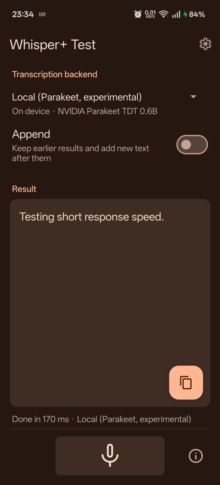
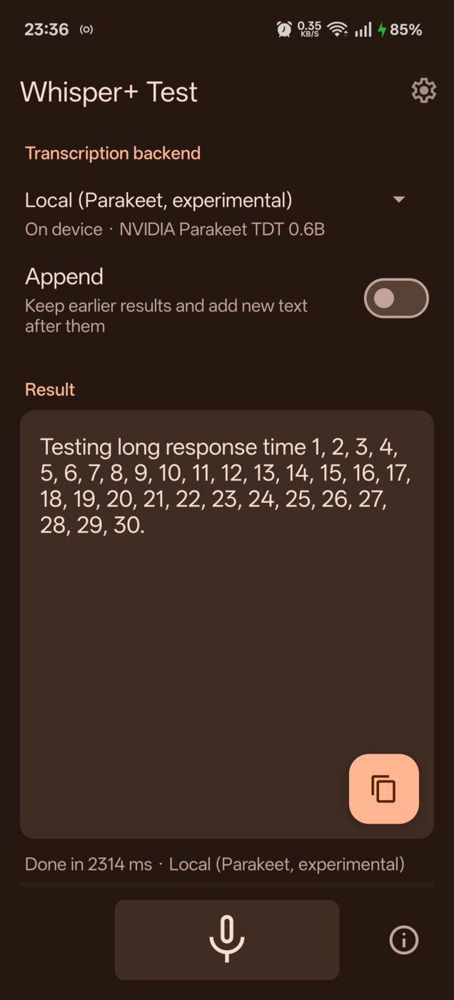

# Chato


A voice keyboard for Android. Hold the mic, speak, and the text lands at the cursor
or is POSTed to a URL you choose. Transcription runs on the phone (Whisper or NVIDIA Parakeet)
or on any OpenAI-compatible server.

Chato is a fork of [Whisper+](https://github.com/woheller69/whisperIMEplus) by woheller69.
It is English-only, and the keyboard was rebuilt around dictating notes.

 

Parakeet on the phone: a short sentence in 170 ms, and a longer dictation (counting to 30) in 2.3 s.

## The keyboard

| | |
|---|---|
|  | **Default.** Text is typed at the cursor. |
|  | **Send to endpoint.** The send target key is lit with a badge showing which endpoint (1 or 2) is active. Dictated text is POSTed there instead of typed. |
|  | **Auto mode** (`A` lit). Tap the mic to start, tap again to stop. |
|  | **Collapsed.** The top row is hidden, leaving only the essentials. |

**Top row**, left to right:
- `-`, `.` and space. Drag on the space key to move the cursor: sideways by characters, up and down by lines.
- Bullet: starts a new `- ` line, or adds `- ` if the cursor is already at the start of a line.
- Status text: shows the current target, upload results and errors inline, so the keyboard doesn't change height.
- Pause other audio key: when lit, music and videos pause while you record, so the mic only hears you. Most apps resume when recording stops; apps that ignore Android's audio focus keep playing.
- Cloud key: switches between the server and the backend on the phone; lit while the server is in use.
- Settings.

**Bottom row**, left to right:
- Collapse/expand the top row.
- Auto mode.
- Send target key: cycles through cursor → endpoint 1 → endpoint 2 and skips endpoints that have no URL. Stays visible when the top row is collapsed.
- Mic.
- Switch back to your normal keyboard.
- Backspace: tap deletes one character; hold deletes whole words and speeds up the longer you hold.
- Enter.

Every key gives a short haptic tick.

## Features

### Recording
- **Hold mode:** the mic records while held and audio is sent in 30 s chunks, which gives the model more context.
- **Auto mode:** audio is sent in 8 s chunks so text appears while you are still speaking. A pause ends the recording; the minimum silence length is set in Settings.
- Chunks are split at the quietest point near the boundary, so words are not cut in half.
- You can keep talking while earlier chunks are still being transcribed.
- Bluetooth headset microphone (optional).

### Transcription backends
Choose one in Settings or on the test screen:
- **Parakeet (recommended):** NVIDIA Parakeet TDT 0.6B v2 (int8 ONNX), runs entirely on the phone, offline. It is English-only, adds punctuation and capitals, and is much faster on short dictation. Choosing it offers to download the model (661 MB) from Hugging Face; each file is checked against a SHA-256 checksum, and an interrupted download resumes.
- **Whisper small:** Whisper small (int8 ONNX), also on the phone and offline. The app downloads the model (243 MB) from Hugging Face, checks it and unpacks it.
- **OpenAI-compatible server:** any OpenAI-compatible `/v1/audio/transcriptions` server. Set its URL, API key and model in Settings. This works with self-hosted servers too, for example a Whisper or Parakeet server on your LAN.

The cloud key on the keyboard switches between the server and whichever backend on the phone you chose last.

Measured on a OnePlus phone with a Snapdragon SM8845 (`make bench`, second run):

| Clip | Whisper small | Parakeet 0.6B |
|---|---|---|
| 3 s | 1.25 s | 0.14 s |
| 11 s | 1.35 s | 0.56 s |
| 30 s | 2.0 s | 2.1 s |
| Peak memory | about 906 MB | about 664 MB |

Whisper always processes a full 30 s window, so even short clips take over a second. Parakeet only processes the audio you recorded.

### Send to endpoint
Up to two endpoints can be configured in Settings. Each has:
- **Name**, shown in the status text.
- **URL.** An endpoint with an empty URL is disabled.
- **Headers**, one per line, e.g. `Authorization: Bearer …`.
- **Body template.** Placeholders:
  - `{{text}}`: the text, escaped for JSON.
  - `{{text_raw}}`: the text exactly as transcribed.
  - `{{timestamp}}`: ISO 8601.
  - `{{name}}`: the endpoint name.
- **One message per recording**, or one message per chunk.

`Content-Type` defaults to `application/json`; set it as a header to change it.
If a send fails, the error is shown and the text is copied to the clipboard, so nothing is lost.

Example: append each dictation as a bullet to a note by replacing a marker in it:

```json
{"edits":[{"oldText":"<!-- voice -->","newText":"- {{text}}\n<!-- voice -->"}]}
```

### Quick record
Record without opening the keyboard: up to 30 s, then the text is sent to an endpoint.
- **Widget:** add the Chato *Quick record* widget to the home screen and pick its endpoint. Place one for each endpoint; each shows its endpoint's number and name. Tap to start, tap again to stop early. It's lit while recording. To change a widget's endpoint, long-press it and choose its settings (Android 12+, if your launcher supports it).
- **Assistant gesture:** in Settings, tap **Use as digital assistant** and choose Chato as the default digital assistant app. The phone's assistant gesture (for example holding the power button, or swiping up from a bottom corner) then starts and stops quick record, sending to the endpoint chosen under **Quick record** in Settings. This replaces your current assistant.

A notification shows while it records and sends, with a Stop button. The result ("Sent to …" or the error) appears as a toast; if sending fails, the text is copied to the clipboard.

### Test screen
Pictured at the top. Open it from the top of Settings, or launch the app. Use it to try each backend:
- pick a backend; the line underneath says what will actually run (on this phone, or which server and model);
- hold the mic to record;
- read the result and the time taken, or any error; copy the text with the button.

### Also included
- **System voice input** (`RecognitionService`) and `RecognizerIntent.ACTION_RECOGNIZE_SPEECH`, so other apps can use it.

The names used for keys, modes and screens are listed in the [glossary](docs/GLOSSARY.md).

## Install

**Download:** get the APK from [Releases](https://github.com/stark-bit/whisperIMEplus/releases) and open it on the phone (allow installing from your browser or file manager when asked). Arm64 phones only, Android 9 or newer.

The package name is `dev.starkbit.chato`, so it installs alongside the original Whisper+ from F-Droid.

**Or build it yourself** (see [Building](#building)).

## Setup

1. Open **Chato** and allow the microphone. The setup screen asks where your speech should be transcribed:
   - **Parakeet (recommended):** downloads the model in the app (661 MB, Wi-Fi recommended).
   - **Whisper small:** downloads the model in the app (243 MB).
   - **OpenAI-compatible server:** opens Settings to set the server URL, API key and model. Plain `http://` works for servers on your own network.
   - **Install Whisper from a zip file:** if you already have `whisper_small_int8.zip` on the phone.

   Downloads are checked against a SHA-256 checksum and resume if interrupted.
2. Hold the mic and speak to check it works. You can switch backends at the top of this screen or in Settings.
3. Enable **Chato** as a keyboard in Android settings (*System › Keyboard › On-screen keyboard*, the name varies by phone).
4. Optional: set up endpoints in **Settings** to send dictation to a URL instead of typing it.

In any text field, switch to Chato with your keyboard's switch key. The keyboard key next to the mic switches back. Some keyboards, e.g. HeliBoard, can open Chato from their mic key.

To use it as system voice input: *System › Languages › Speech › Voice input*. If it does not appear in that list:

```
adb shell settings put secure voice_recognition_service dev.starkbit.chato/com.whisperonnx.WhisperRecognitionService
```

## Building

You need:
- **JDK 17**;
- the **Android SDK** with platform 35. Android Studio installs both. Point the build at the SDK with `ANDROID_HOME`, or a `local.properties` file containing `sdk.dir=/path/to/Android/Sdk`;
- `make` and `adb` for the shortcuts below. Plain `./gradlew assembleDebug` also works.

```
git clone https://github.com/stark-bit/whisperIMEplus.git
cd whisperIMEplus
make run       # build the debug APK and install it on the connected phone (USB debugging on)
```

Other targets:

```
make build     # debug APK only: app/build/outputs/apk/debug/app-debug.apk
make test      # JVM unit tests, no device needed
make check     # package boundaries, comments, complexity, lint and unit tests
make bench     # compare Whisper and Parakeet on the phone using the WAVs in bench/
make push-parakeet PARAKEET_DIR=/path/to/models  # copy Parakeet files over USB instead of downloading
make release   # signed release APK in dist/ (needs a signing key, see below)
make help      # all targets
```

A debug build and a release build are signed with different keys and can't replace each other. Uninstall one before installing the other; this deletes the app's settings and models.

**Release signing.** `make release` signs with the key named in `~/.gradle/gradle.properties`:

```
CHATO_KEYSTORE=/path/to/release.jks
CHATO_KEYSTORE_PASSWORD=…
CHATO_KEY_ALIAS=…
CHATO_KEY_PASSWORD=…
```

Without these properties the release APK is built unsigned. Android won't install an unsigned APK until you sign it yourself.

## License

GPLv3, © woheller69. Fork changes are under the same license.
- Based on [whisperIME](https://github.com/woheller69/whisperIME) (MIT).
- Uses code and the Whisper ONNX models from [RTranslator](https://github.com/niedev/RTranslator).
- Uses code from [Whisper-Android](https://github.com/vilassn/whisper_android) (MIT).
- Uses [OpenAI Whisper](https://github.com/openai/whisper) (MIT). Details are in the [paper](https://arxiv.org/abs/2212.04356).
- Uses [Android VAD](https://github.com/gkonovalov/android-vad) (MIT).
- The Whisper model is downloaded from [HuggingFace](https://huggingface.co/DocWolle/whisperOnnx) (MIT).
- The optional Parakeet model is [NVIDIA Parakeet TDT 0.6B v2](https://huggingface.co/nvidia/parakeet-tdt-0.6b-v2) (CC-BY-4.0), in the ONNX export by [istupakov](https://huggingface.co/istupakov/parakeet-tdt-0.6b-v2-onnx).

---

## Original Whisper+

For reference, this is how the upstream app looked before this fork. It has a
standalone recorder and a keyboard with two preset languages (`1`/`2`), auto mode (`A`),
and translation to English.

 

Upstream project, F-Droid listing and donation links: [woheller69/whisperIMEplus](https://github.com/woheller69/whisperIMEplus).
