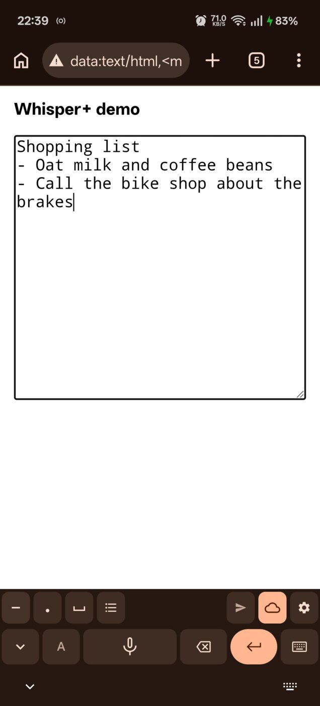
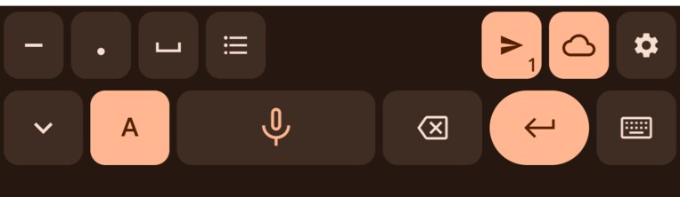
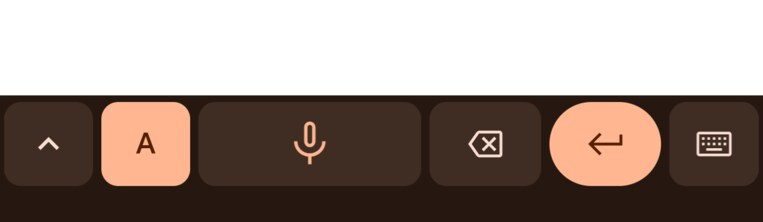

# Whisper+ (stark-bit fork)

A voice keyboard for Android. Hold the mic, speak, and the text lands at the cursor
or is POSTed to a URL you choose. Transcription runs on the phone (Whisper ONNX)
or on any OpenAI-compatible server.

This is a fork of [woheller69/whisperIMEplus](https://github.com/woheller69/whisperIMEplus).
It is English-only, and the keyboard was rebuilt around dictating notes.



## The keyboard

| | |
|---|---|
|  | **Default.** Text is typed at the cursor. |
|  | **Send to endpoint.** The send key is lit with a badge showing which endpoint (1 or 2) is active. Dictated text is POSTed there instead of typed. |
|  | **Auto mode** (`A` lit). Tap the mic to start, tap again to stop. |
|  | **Collapsed.** The top row is hidden, leaving only the essentials. |

**Top row**, left to right:
- `-`, `.` and space.
- Bullet: starts a new `- ` line, or adds `- ` if the cursor is already at the start of a line.
- Status text: shows the current target, upload results and errors inline, so the keyboard doesn't change height.
- Send target: cycles through cursor → endpoint 1 → endpoint 2 and skips endpoints that have no URL.
- Backend toggle: the cloud key is lit while the remote backend is in use.
- Settings.

**Bottom row**, left to right:
- Collapse/expand the top row.
- Auto mode.
- Mic.
- Backspace: tap deletes one character; hold deletes whole words and speeds up the longer you hold.
- Enter.
- Switch back to your normal keyboard.

Every key gives a short haptic tick.

## Features

### Recording
- **Hold-to-talk:** the mic records while held and audio is sent in 30 s chunks, which gives the model more context.
- **Auto mode:** audio is sent in 8 s chunks so text appears while you are still speaking. A pause ends the recording; the minimum silence length is set in Settings.
- Chunks are split at the quietest point near the boundary, so words are not cut in half.
- You can keep talking while earlier chunks are still being transcribed.
- Bluetooth headset microphone (optional).

### Transcription backends
- **Local (ONNX):** Whisper runs entirely on the phone, offline. The model is downloaded from HuggingFace on first launch.
- **OpenAI API:** any OpenAI-compatible `/v1/audio/transcriptions` server. Set its URL, API key and model in Settings. This works with self-hosted servers too, for example a Whisper or Parakeet server on your LAN.
- Switch between the two with the cloud key without leaving the keyboard.

### Send to endpoint
Up to two endpoints can be configured in Settings. Each has:
- **Name**, shown in the status text.
- **URL.** An endpoint with an empty URL is disabled.
- **Headers**, one per line, e.g. `Authorization: Bearer …`.
- **Body template.** Placeholders:
  - `{{text}}`: the text, escaped for JSON.
  - `{{text_raw}}`: the text exactly as transcribed.
  - `{{timestamp}}`: ISO 8601.
  - `{{name}}`: the endpoint name.
- **One message per recording**, or one message per chunk.

`Content-Type` defaults to `application/json`; set it as a header to change it.
If a send fails, the error is shown and the text is copied to the clipboard, so nothing is lost.

Example: append each dictation as a bullet to a note by replacing a marker in it:

```json
{"edits":[{"oldText":"<!-- voice -->","newText":"- {{text}}\n<!-- voice -->"}]}
```

### Also included
- **Standalone app:** record, then copy the transcript.
- **System voice input** (`RecognitionService`) and `RecognizerIntent.ACTION_RECOGNIZE_SPEECH`, so other apps can use it.

## Setup

1. Install the app, open it and download the Whisper model (needed for the local backend).
2. Enable **Whisper+** as a keyboard in Android settings.
3. Optional: in **Settings**, configure the OpenAI-compatible backend and endpoints.
4. Use the keyboard's last key to switch back to your normal keyboard. Some keyboards, e.g. HeliBoard, can open Whisper+ from their mic key.

To use it as system voice input: *System › Languages › Speech › Voice input*. If it does not appear in that list:

```
adb shell settings put secure voice_recognition_service org.woheller69.whisperplus/com.whisperonnx.WhisperRecognitionService
```

## Building

```
make build     # debug APK
make run       # build and install on a connected device
make test      # JVM unit tests, no device needed
make help      # all targets
```

## License

GPLv3, © woheller69. Fork changes are under the same license.
- Based on [whisperIME](https://github.com/woheller69/whisperIME) (MIT).
- Uses code and the Whisper ONNX models from [RTranslator](https://github.com/niedev/RTranslator).
- Uses code from [Whisper-Android](https://github.com/vilassn/whisper_android) (MIT).
- Uses [OpenAI Whisper](https://github.com/openai/whisper) (MIT). Details are in the [paper](https://arxiv.org/abs/2212.04356).
- Uses [Android VAD](https://github.com/gkonovalov/android-vad) (MIT).
- The model is downloaded from [HuggingFace](https://huggingface.co/DocWolle/whisperOnnx) (MIT).

---

## Original Whisper+

For reference, this is how the upstream app looked before this fork. It has a
standalone recorder and a keyboard with two preset languages (`1`/`2`), auto mode (`A`),
and translation to English.

 

Upstream project, F-Droid listing and donation links: [woheller69/whisperIMEplus](https://github.com/woheller69/whisperIMEplus).
